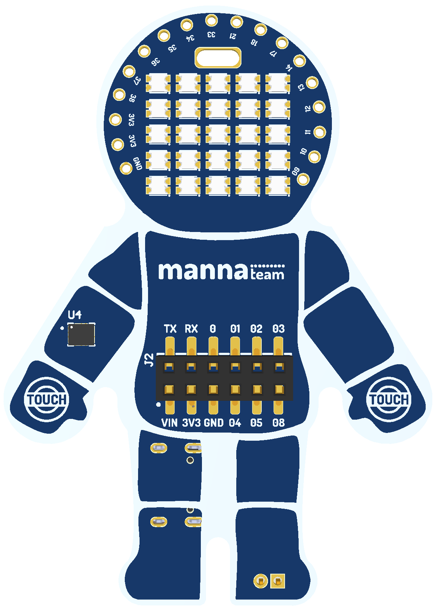

# mannaNAUTA 🚀

**Explore Technology, Inspire Learning!**

**Language:** English | [Português (Brasil)](README.pt-BR.md)

  

## About mannaNAUTA

mannaNAUTA is an educational development board powered by the **ESP32-S3** microcontroller, featuring a unique **astronaut-shaped design** that brings creativity, technology, and hands-on learning together.

Designed to make technology education more engaging and accessible, mannaNAUTA provides a versatile platform for exploring **electronics, programming, the Internet of Things (IoT), robotics, and Education 5.0**.

By combining practical experimentation with creative problem-solving, mannaNAUTA encourages students, educators, and makers to transform ideas into interactive projects and discover new possibilities through technology.

mannaNAUTA was developed to support the educational activities of the Manna Ecosystem and is used in workshops, microcredentials, academic courses, bootcamps, and other training initiatives. The board is designed to provide practical, creative, and interactive learning experiences, bringing participants closer to emerging technologies while encouraging the development of new skills and competencies.

Learn more about the Manna Ecosystem at [www.manna.team](https://www.manna.team/).

## Educational Applications

- **Electronics:** Explore electronic components, sensors, actuators, and connections through hands-on activities.
- **Programming:** Develop computational thinking and programming skills through real-world experiments.
- **Internet of Things (IoT):** Create connected projects that interact with the physical world.
- **Robotics:** Experiment with sensing, control, movement, and interactive systems.
- **Education 5.0:** Encourage creativity, collaboration, problem-solving, and human-centered learning through technology.

## Board Highlights

- ESP32-S3 microcontroller with Wi-Fi and Bluetooth Low Energy
- Onboard addressable RGB LED array controlled through GPIO47
- Onboard LSM6DS motion sensor connected through I²C
- Two capacitive touch pads
- USB connector for programming and power
- Expansion connections for power, serial communication and GPIO

## Pinout Maps

The board's pinout maps help identify connections and plan educational projects.

➡️ **[View the pinout documentation](docs/pinout/README.md)** or open the
**[complete pinout map (PDF)](docs/pinout/mannaNAUTA%20-%20Pinout.pdf)**.

## Libraries

Dedicated Arduino libraries are available to simplify development with mannaNAUTA:

| Library | Description |
| --- | --- |
| [mannaNAUTA_WS2812_Lib](https://github.com/wuigor/mannaNAUTA_WS2812_Lib) | Control WS2812 addressable RGB LEDs, colors, effects, and visual patterns. |
| [mannaNAUTA_LSM6DS_Lib](https://github.com/wuigor/mannaNAUTA_LSM6DS_Lib) | Interface with the LSM6DS inertial sensor family to read motion and orientation-related data. |

For installation and usage instructions, visit each library's repository.

## Getting Started

Explore the [getting started guide](docs/getting-started/README.md) for an overview of how to begin working with the board and its software resources.

## Examples

Programming examples will be organized in the [examples directory](examples/README.md).

---

**mannaNAUTA**
