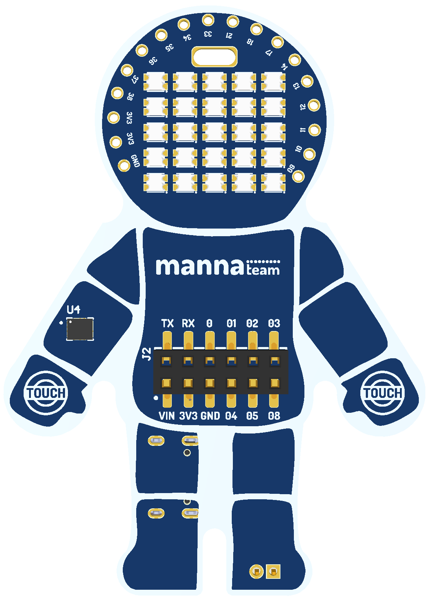

# mannaNAUTA 🚀

**Explore a Tecnologia, Inspire a Aprendizagem!**

**Idioma:** [English](README.md) | Português (Brasil)

  

## Sobre a mannaNAUTA

A mannaNAUTA é uma placa de desenvolvimento educacional baseada no microcontrolador **ESP32-S3**, que apresenta um **formato exclusivo de astronauta**, unindo criatividade, tecnologia e aprendizagem prática.

Desenvolvida para tornar o ensino de tecnologia mais envolvente e acessível, a mannaNAUTA oferece uma plataforma versátil para explorar **eletrônica, programação, Internet das Coisas (IoT), robótica e Educação 5.0**.

Ao combinar experimentação prática com resolução criativa de problemas, a mannaNAUTA incentiva estudantes, educadores e entusiastas a transformar ideias em projetos interativos e descobrir novas possibilidades por meio da tecnologia.

A mannaNAUTA foi desenvolvida para apoiar as atividades educacionais do Ecossistema Manna, sendo utilizada em workshops, microcredenciais, disciplinas, bootcamps e outras iniciativas de formação. A placa busca proporcionar experiências de aprendizagem práticas, criativas e interativas, aproximando os participantes das tecnologias emergentes e incentivando o desenvolvimento de novas habilidades e competências.

Conheça mais sobre o Ecossistema Manna em [www.manna.team](https://www.manna.team/).

## Aplicações Educacionais

- **Eletrônica:** Explore componentes eletrônicos, sensores, atuadores e conexões por meio de atividades práticas.
- **Programação:** Desenvolva o pensamento computacional e habilidades de programação com experiências reais.
- **Internet das Coisas (IoT):** Crie projetos conectados que interagem com o mundo físico.
- **Robótica:** Experimente conceitos de sensoriamento, controle, movimento e sistemas interativos.
- **Educação 5.0:** Estimule criatividade, colaboração, resolução de problemas e aprendizagem centrada nas pessoas por meio da tecnologia.

## Destaques da Placa

- Microcontrolador ESP32-S3 com Wi-Fi e Bluetooth Low Energy
- Conjunto integrado de LEDs RGB endereçáveis controlado pelo GPIO47
- Sensor de movimento LSM6DS integrado e conectado via I²C
- Dois pads touch capacitivos
- Conector USB para programação e alimentação
- Conexões de expansão para alimentação, comunicação serial e GPIO

## Mapas de Pinos

Os mapas de pinos da placa ajudam a identificar conexões e planejar projetos educacionais.

➡️ **[Acesse a documentação do mapa de pinos](docs/pinout/README.pt-BR.md)** ou abra o
**[mapa de pinos completo (PDF)](docs/pinout/mannaNAUTA%20-%20Pinout.pdf)**.

## Bibliotecas

Bibliotecas Arduino específicas estão disponíveis para facilitar o desenvolvimento com a mannaNAUTA:

| Biblioteca | Descrição |
| --- | --- |
| [mannaNAUTA_WS2812_Lib](https://github.com/wuigor/mannaNAUTA_WS2812_Lib) | Controle de LEDs RGB endereçáveis WS2812, cores, efeitos e padrões visuais. |
| [mannaNAUTA_LSM6DS_Lib](https://github.com/wuigor/mannaNAUTA_LSM6DS_Lib) | Interface com sensores inerciais da família LSM6DS para leitura de dados de movimento e orientação. |

Para instalação e instruções de uso, consulte o repositório de cada biblioteca.

## Primeiros Passos

Acesse o [guia de primeiros passos](docs/getting-started/README.pt-BR.md) para conhecer os recursos iniciais de software e utilização da placa.

## Exemplos

Os exemplos de programação serão organizados no [diretório de exemplos](examples/README.md).

---

**mannaNAUTA**
