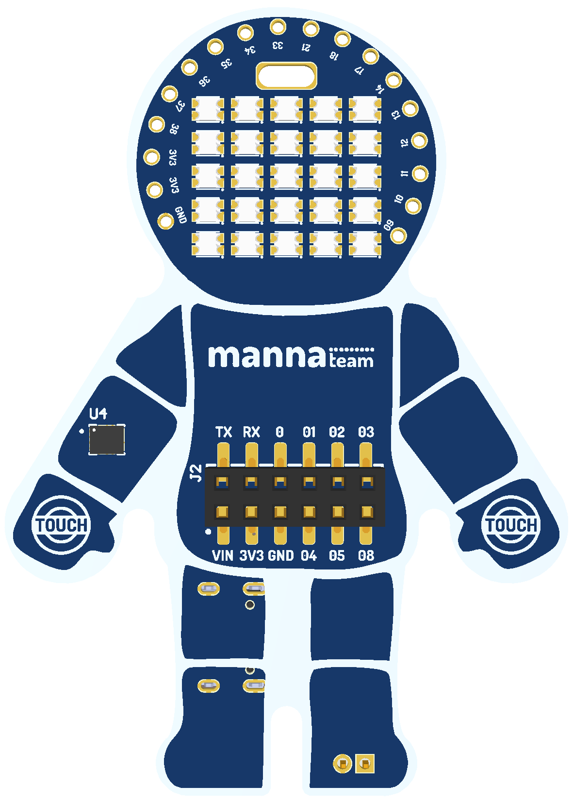
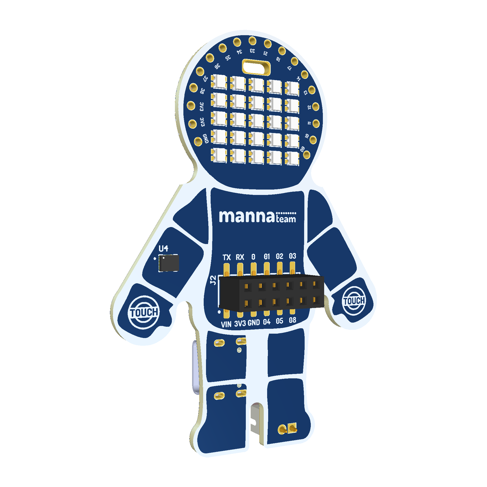
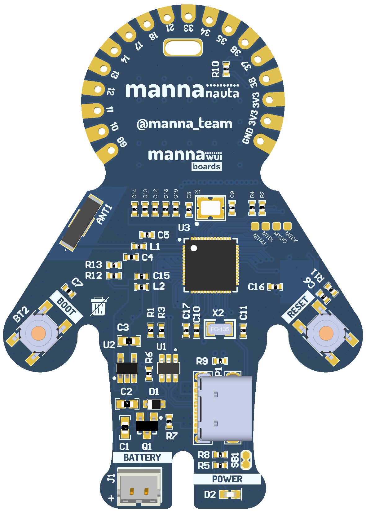
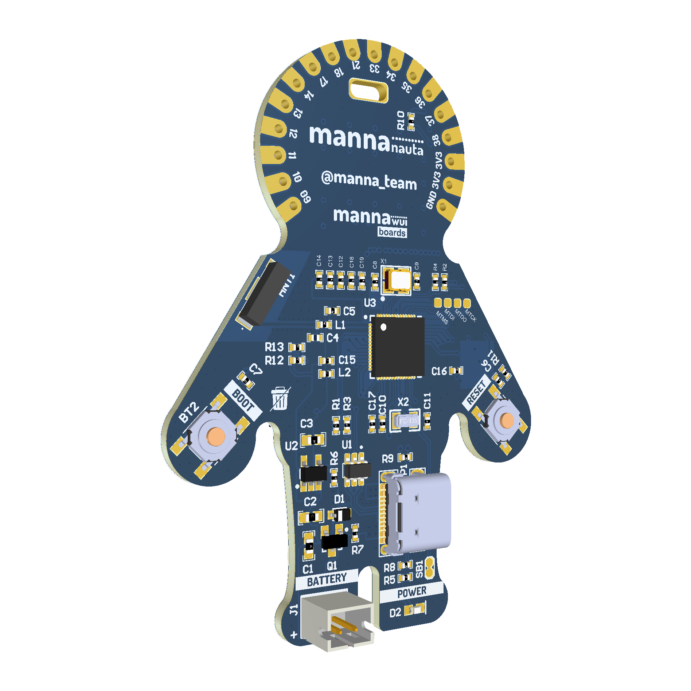

# mannaNAUTA Pinout

**Language:** English | [Português (Brasil)](README.pt-BR.md)

The pinout map identifies the board connectors, power pins, built-in
peripherals, and alternate functions exposed by the ESP32-S3.

➡️ **[Open the complete pinout map (PDF)](mannaNAUTA%20-%20Pinout.pdf)**

## Board views

### Front

### Back

## Built-in hardware

| Function | Pin | Notes |
| --- | --- | --- |
| Addressable LEDs | GPIO47 | Data signal for the onboard LED array |
| LSM6DS SDA | GPIO5 | I²C data |
| LSM6DS SCL | GPIO4 | I²C clock |
| LSM6DS address | `0x6A` | 7-bit I²C address |
| Left touch pad | GPIO7 | Touch channel 7 |
| Right touch pad | GPIO6 | Touch channel 6 |
| BOOT button | GPIO0 | Boot selection; also available on J2 |
| UART TX | GPIO43 | `U0TXD`, available on J2 |
| UART RX | GPIO44 | `U0RXD`, available on J2 |

## Expansion connector J2

| Label | Signal |
| --- | --- |
| TX | GPIO43 (`U0TXD`) |
| RX | GPIO44 (`U0RXD`) |
| 0 | GPIO0 |
| 01 | GPIO1 |
| 02 | GPIO2 |
| 03 | GPIO3 |
| VIN | Input supply |
| 3V3 | 3.3 V supply |
| GND | Ground |
| 04 | GPIO4 |
| 05 | GPIO5 |
| 08 | GPIO8 |

## Exposed GPIO

The upper headers (located on the astronaut's head) expose GPIO9 through
GPIO14, GPIO17, GPIO18, GPIO21, and GPIO33 through GPIO38. Their ADC, touch,
RTC, SPI, and clock alternate functions are detailed in the PDF.

> [!CAUTION]
> ESP32-S3 GPIOs operate at 3.3 V and are not 5 V tolerant.
