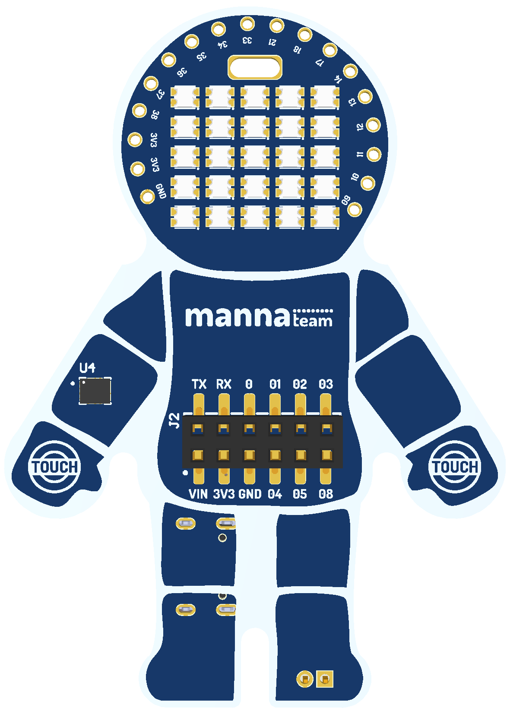
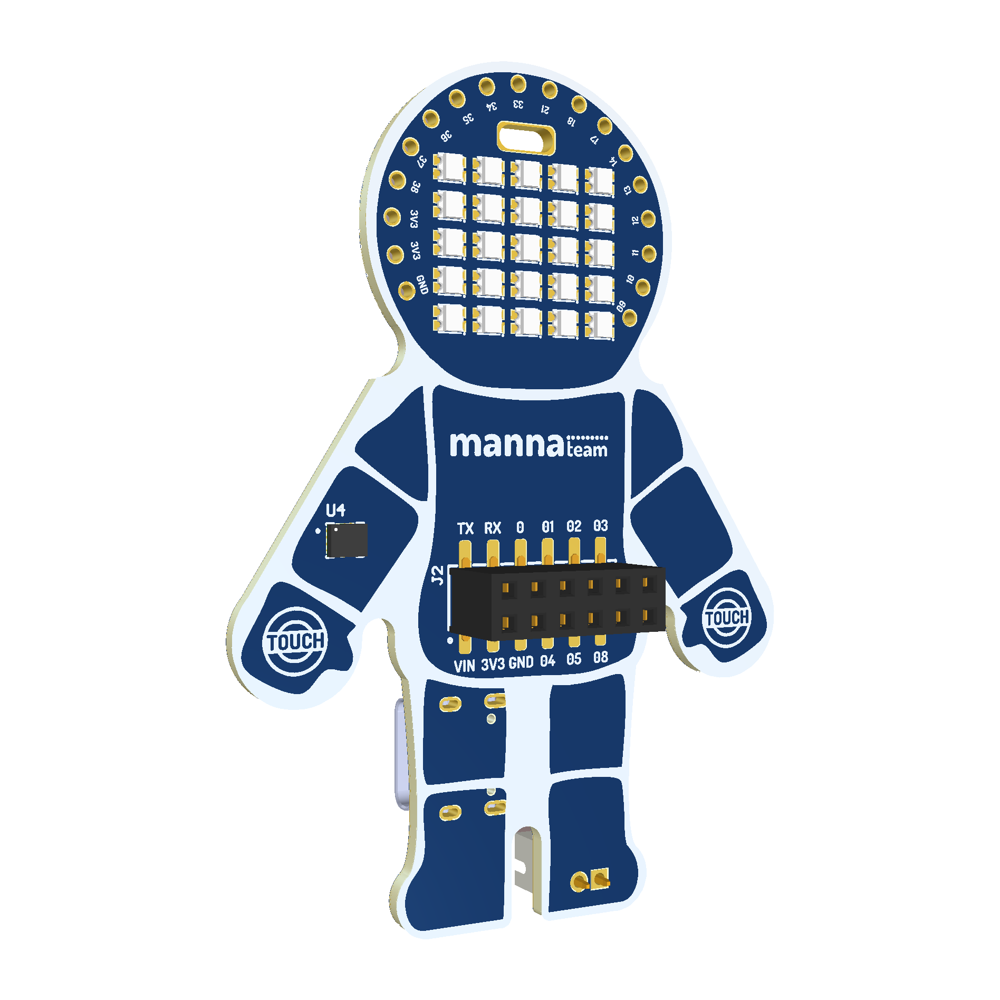
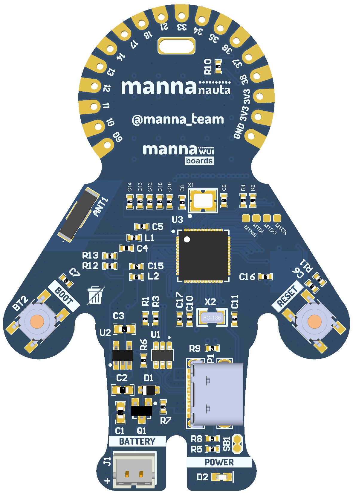
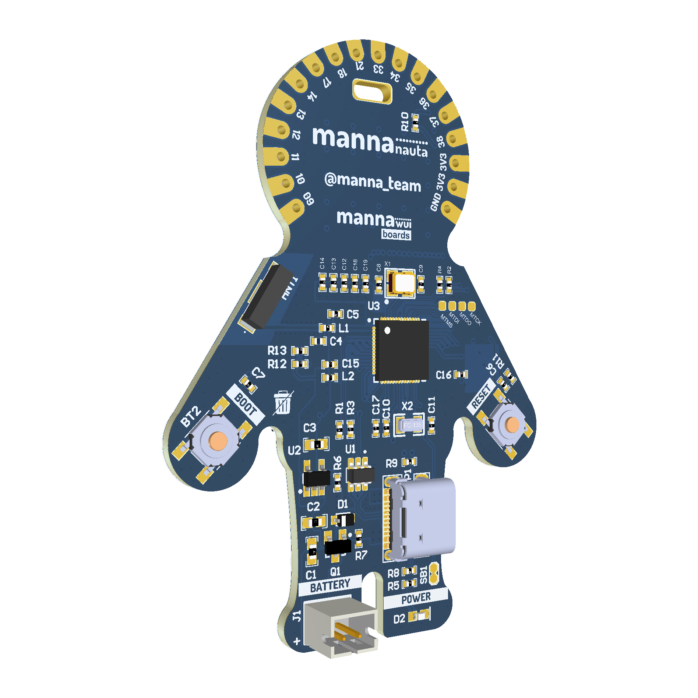

# Mapa de pinos da mannaNAUTA

**Idioma:** [English](README.md) | Português (Brasil)

O mapa de pinos identifica os conectores, pinos de alimentação, periféricos
integrados e funções alternativas disponibilizadas pelo ESP32-S3.

➡️ **[Abrir o mapa de pinos completo (PDF)](mannaNAUTA%20-%20Pinout.pdf)**

## Imagens da placa

### Frente

  

  

### Verso

  

  

## Hardware integrado

| Função | Pino | Observações |
| --- | --- | --- |
| LEDs endereçáveis | GPIO47 | Sinal de dados do conjunto de LEDs |
| LSM6DS SDA | GPIO5 | Dados I²C |
| LSM6DS SCL | GPIO4 | Clock I²C |
| Endereço LSM6DS | `0x6A` | Endereço I²C de 7 bits |
| Pad touch esquerdo | GPIO7 | Canal touch 7 |
| Pad touch direito | GPIO6 | Canal touch 6 |
| Botão BOOT | GPIO0 | Seleção de boot; também disponível no J2 |
| UART TX | GPIO43 | `U0TXD`, disponível no J2 |
| UART RX | GPIO44 | `U0RXD`, disponível no J2 |

## Conector de expansão J2

| Identificação | Sinal |
| --- | --- |
| TX | GPIO43 (`U0TXD`) |
| RX | GPIO44 (`U0RXD`) |
| 0 | GPIO0 |
| 01 | GPIO1 |
| 02 | GPIO2 |
| 03 | GPIO3 |
| VIN | Alimentação de entrada |
| 3V3 | Alimentação de 3,3 V |
| GND | Terra |
| 04 | GPIO4 |
| 05 | GPIO5 |
| 08 | GPIO8 |

## GPIO disponível

Os conectores superiores disponibilizam os GPIO9 a GPIO14, GPIO17, GPIO18,
GPIO21 e GPIO33 a GPIO38. As funções alternativas de ADC, touch, RTC, SPI e
clock estão detalhadas no PDF.

> [!CAUTION]
> Os GPIOs do ESP32-S3 operam em 3,3 V e não são tolerantes a 5 V.
